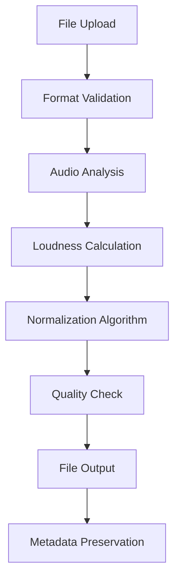

# Design Document

## Overview

Il sistema di normalizzazione audio è progettato come un'applicazione web Next.js che combina un'interfaccia utente React moderna con un backend Node.js per il processing audio. L'architettura utilizza Web Workers per il processing intensivo e librerie specializzate per l'analisi e manipolazione audio, garantendo performance ottimali e un'esperienza utente fluida.

Il sistema supporta il processing batch di album completi, offrendo diversi algoritmi di normalizzazione (peak e loudness-based) con anteprima in tempo reale dei risultati.

## Architecture

### Frontend Architecture
- **Framework**: Next.js 15 con React 19
- **UI Components**: Radix UI con Tailwind CSS per styling
- **State Management**: React hooks (useState, useContext) per gestione stato locale
- **File Handling**: File API del browser per upload e preview
- **Audio Processing**: Web Audio API per analisi client-side e preview

### Backend Architecture
- **Runtime**: Node.js con supporto per librerie native
- **Audio Processing**: 
  - `node-ffmpeg` per conversione e manipolazione formati
  - `loudness` per calcoli LUFS/EBU R128
  - `audio-buffer-utils` per manipolazione buffer audio
- **File System**: `fs/promises` per gestione asincrona file
- **API Routes**: Next.js API routes per endpoints RESTful

### Processing Pipeline


## Components and Interfaces

### Core Components

#### 1. AudioProcessor Service
```typescript
interface AudioProcessor {
  analyzeAudio(filePath: string): Promise<AudioAnalysis>
  normalizeAudio(filePath: string, options: NormalizationOptions): Promise<string>
  validateFormat(filePath: string): Promise<boolean>
}

interface AudioAnalysis {
  duration: number
  sampleRate: number
  channels: number
  peakLevel: number // dB
  rmsLevel: number // dB
  lufsIntegrated: number // LUFS
  truePeak: number // dBTP
  hasClipping: boolean
}

interface NormalizationOptions {
  method: 'peak' | 'loudness'
  targetLevel: number // dB or LUFS
  preserveFormat: boolean
  outputPath: string
}
```

#### 2. FileManager Service
```typescript
interface FileManager {
  uploadFiles(files: File[]): Promise<UploadResult[]>
  validateAudioFile(file: File): Promise<ValidationResult>
  createOutputDirectory(albumName: string): Promise<string>
  preserveMetadata(sourcePath: string, targetPath: string): Promise<void>
}

interface UploadResult {
  id: string
  originalName: string
  tempPath: string
  size: number
  format: string
}
```

#### 3. AlbumProcessor Service
```typescript
interface AlbumProcessor {
  processAlbum(files: AudioFile[], options: AlbumOptions): Promise<ProcessingResult>
  calculateAlbumLoudness(files: AudioFile[]): Promise<AlbumLoudnessData>
  generateProcessingReport(results: ProcessingResult[]): ProcessingReport
}

interface AlbumOptions {
  normalizationMethod: 'peak' | 'loudness'
  targetLevel: number
  maintainRelativeLoudness: boolean
  outputFormat: string
}
```

### UI Components Enhancement

#### 1. AudioAnalysisDisplay
- Visualizzazione waveform con Canvas API
- Grafici di loudness range con Recharts
- Indicatori di clipping e dynamic range

#### 2. NormalizationPreview
- Player audio integrato per A/B comparison
- Slider per regolazione parametri in tempo reale
- Visualizzazione before/after levels

#### 3. ProcessingQueue
- Progress tracking per ogni file
- Gestione errori e retry logic
- Stima tempo rimanente

## Data Models

### AudioFile Model
```typescript
interface AudioFile {
  id: string
  name: string
  originalPath: string
  tempPath?: string
  size: number
  format: string
  analysis?: AudioAnalysis
  normalizationResult?: NormalizationResult
  status: 'uploaded' | 'analyzing' | 'ready' | 'processing' | 'completed' | 'error'
  error?: string
}
```

### Album Model
```typescript
interface Album {
  id: string
  name: string
  files: AudioFile[]
  settings: AlbumSettings
  overallLoudness?: number
  processingStatus: 'pending' | 'analyzing' | 'ready' | 'processing' | 'completed'
  createdAt: Date
  completedAt?: Date
}

interface AlbumSettings {
  normalizationMethod: 'peak' | 'loudness'
  targetLevel: number
  outputFormat: string
  maintainRelativeLoudness: boolean
  outputDirectory: string
}
```

### Processing Result Model
```typescript
interface ProcessingResult {
  fileId: string
  success: boolean
  outputPath?: string
  originalLoudness: number
  finalLoudness: number
  gainApplied: number
  processingTime: number
  error?: string
}
```

## Error Handling

### Client-Side Error Handling
- **File Validation Errors**: Formato non supportato, file corrotto
- **Upload Errors**: Dimensione eccessiva, connessione interrotta
- **Processing Errors**: Timeout, memoria insufficiente
- **UI Error Boundaries**: Fallback components per errori React

### Server-Side Error Handling
- **Audio Processing Errors**: Codec non supportato, file danneggiato
- **File System Errors**: Permessi, spazio disco insufficiente
- **Memory Management**: Cleanup automatico file temporanei
- **Graceful Degradation**: Fallback per funzionalità avanzate

### Error Recovery Strategies
```typescript
interface ErrorRecoveryStrategy {
  retryableErrors: string[]
  maxRetries: number
  backoffStrategy: 'linear' | 'exponential'
  fallbackOptions: FallbackOption[]
}
```

## Testing Strategy

### Unit Testing
- **Audio Processing Functions**: Test con file audio di esempio
- **Loudness Calculations**: Validazione contro reference standards
- **File Operations**: Mock file system per test isolati
- **UI Components**: React Testing Library per interazioni

### Integration Testing
- **End-to-End Processing**: Upload → Analysis → Normalization → Download
- **Format Compatibility**: Test con diversi formati audio
- **Error Scenarios**: Simulazione errori di processing
- **Performance Testing**: Processing di album di grandi dimensioni

### Test Data
- **Reference Audio Files**: Set di file con loudness note
- **Edge Cases**: File mono/stereo, sample rate diversi, formati compressi
- **Corrupted Files**: Test robustezza error handling

### Performance Benchmarks
- **Processing Speed**: Target < 2x durata reale per normalizzazione
- **Memory Usage**: Limite 500MB per album di 20 tracce
- **Concurrent Processing**: Supporto per 3-5 file simultanei
- **UI Responsiveness**: Aggiornamenti progress < 100ms

## Security Considerations

### File Upload Security
- **File Type Validation**: Whitelist formati audio supportati
- **Size Limits**: Limite 100MB per file, 2GB per album
- **Virus Scanning**: Integrazione con servizi di scanning
- **Temporary File Cleanup**: Rimozione automatica dopo processing

### Data Privacy
- **Local Processing**: Nessun upload su server esterni
- **Metadata Handling**: Preservazione solo metadati audio essenziali
- **File Encryption**: Crittografia file temporanei sensibili

## Deployment Architecture

### Development Environment
- **Local Development**: Next.js dev server con hot reload
- **Audio Libraries**: Installazione native dependencies
- **Test Environment**: Docker container per consistency

### Production Considerations
- **Server Requirements**: CPU multi-core, RAM 8GB+, SSD storage
- **Scaling Strategy**: Horizontal scaling con load balancer
- **Monitoring**: Logging processing times e error rates
- **Backup Strategy**: Backup configurazioni e file temporanei critici