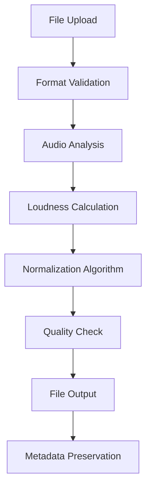

# Design Document

## Overview

The audio normalization system is designed as a Next.js web application that combines a modern React user interface with a Node.js backend for audio processing. The architecture uses Web Workers for intensive processing and specialized libraries for audio analysis and manipulation, ensuring optimal performance and a smooth user experience.

The system supports batch processing of complete albums, offering several normalization algorithms (peak and loudness-based) with a real-time preview of the results.

## Architecture

### Frontend Architecture
- **Framework**: Next.js 15 with React 19
- **UI Components**: Radix UI with Tailwind CSS for styling
- **State Management**: React hooks (useState, useContext) for local state management
- **File Handling**: Browser File API for upload and preview
- **Audio Processing**: Web Audio API for client-side analysis and preview

### Backend Architecture
- **Runtime**: Node.js with support for native libraries
- **Audio Processing**: 
  - `node-ffmpeg` for format conversion and manipulation
  - `loudness` for LUFS/EBU R128 calculations
  - `audio-buffer-utils` for audio buffer manipulation
- **File System**: `fs/promises` for asynchronous file management
- **API Routes**: Next.js API routes for RESTful endpoints

### Processing Pipeline


## Components and Interfaces

### Core Components

#### 1. AudioProcessor Service
```typescript
interface AudioProcessor {
  analyzeAudio(filePath: string): Promise<AudioAnalysis>
  normalizeAudio(filePath: string, options: NormalizationOptions): Promise<string>
  validateFormat(filePath: string): Promise<boolean>
}

interface AudioAnalysis {
  duration: number
  sampleRate: number
  channels: number
  peakLevel: number // dB
  rmsLevel: number // dB
  lufsIntegrated: number // LUFS
  truePeak: number // dBTP
  hasClipping: boolean
}

interface NormalizationOptions {
  method: 'peak' | 'loudness'
  targetLevel: number // dB or LUFS
  preserveFormat: boolean
  outputPath: string
}
```

#### 2. FileManager Service
```typescript
interface FileManager {
  uploadFiles(files: File[]): Promise<UploadResult[]>
  validateAudioFile(file: File): Promise<ValidationResult>
  createOutputDirectory(albumName: string): Promise<string>
  preserveMetadata(sourcePath: string, targetPath: string): Promise<void>
}

interface UploadResult {
  id: string
  originalName: string
  tempPath: string
  size: number
  format: string
}
```

#### 3. AlbumProcessor Service
```typescript
interface AlbumProcessor {
  processAlbum(files: AudioFile[], options: AlbumOptions): Promise<ProcessingResult>
  calculateAlbumLoudness(files: AudioFile[]): Promise<AlbumLoudnessData>
  generateProcessingReport(results: ProcessingResult[]): ProcessingReport
}

interface AlbumOptions {
  normalizationMethod: 'peak' | 'loudness'
  targetLevel: number
  maintainRelativeLoudness: boolean
  outputFormat: string
}
```

### UI Components Enhancement

#### 1. AudioAnalysisDisplay
- Waveform display with the Canvas API
- Loudness range charts with Recharts
- Clipping and dynamic range indicators

#### 2. NormalizationPreview
- Built-in audio player for A/B comparison
- Sliders for real-time parameter adjustment
- Before/after level display

#### 3. ProcessingQueue
- Progress tracking for each file
- Error handling and retry logic
- Remaining time estimate

## Data Models

### AudioFile Model
```typescript
interface AudioFile {
  id: string
  name: string
  originalPath: string
  tempPath?: string
  size: number
  format: string
  analysis?: AudioAnalysis
  normalizationResult?: NormalizationResult
  status: 'uploaded' | 'analyzing' | 'ready' | 'processing' | 'completed' | 'error'
  error?: string
}
```

### Album Model
```typescript
interface Album {
  id: string
  name: string
  files: AudioFile[]
  settings: AlbumSettings
  overallLoudness?: number
  processingStatus: 'pending' | 'analyzing' | 'ready' | 'processing' | 'completed'
  createdAt: Date
  completedAt?: Date
}

interface AlbumSettings {
  normalizationMethod: 'peak' | 'loudness'
  targetLevel: number
  outputFormat: string
  maintainRelativeLoudness: boolean
  outputDirectory: string
}
```

### Processing Result Model
```typescript
interface ProcessingResult {
  fileId: string
  success: boolean
  outputPath?: string
  originalLoudness: number
  finalLoudness: number
  gainApplied: number
  processingTime: number
  error?: string
}
```

## Error Handling

### Client-Side Error Handling
- **File Validation Errors**: Unsupported format, corrupted file
- **Upload Errors**: Excessive size, interrupted connection
- **Processing Errors**: Timeout, insufficient memory
- **UI Error Boundaries**: Fallback components for React errors

### Server-Side Error Handling
- **Audio Processing Errors**: Unsupported codec, damaged file
- **File System Errors**: Permissions, insufficient disk space
- **Memory Management**: Automatic cleanup of temporary files
- **Graceful Degradation**: Fallback for advanced features

### Error Recovery Strategies
```typescript
interface ErrorRecoveryStrategy {
  retryableErrors: string[]
  maxRetries: number
  backoffStrategy: 'linear' | 'exponential'
  fallbackOptions: FallbackOption[]
}
```

## Testing Strategy

### Unit Testing
- **Audio Processing Functions**: Tests with sample audio files
- **Loudness Calculations**: Validation against reference standards
- **File Operations**: Mocked file system for isolated tests
- **UI Components**: React Testing Library for interactions

### Integration Testing
- **End-to-End Processing**: Upload → Analysis → Normalization → Download
- **Format Compatibility**: Tests with different audio formats
- **Error Scenarios**: Simulation of processing errors
- **Performance Testing**: Processing of large albums

### Test Data
- **Reference Audio Files**: Set of files with known loudness
- **Edge Cases**: Mono/stereo files, different sample rates, compressed formats
- **Corrupted Files**: Error handling robustness tests

### Performance Benchmarks
- **Processing Speed**: Target < 2x real duration for normalization
- **Memory Usage**: Limit of 500MB for a 20-track album
- **Concurrent Processing**: Support for 3-5 simultaneous files
- **UI Responsiveness**: Progress updates < 100ms

## Security Considerations

### File Upload Security
- **File Type Validation**: Whitelist of supported audio formats
- **Size Limits**: Limit of 100MB per file, 2GB per album
- **Virus Scanning**: Integration with scanning services
- **Temporary File Cleanup**: Automatic removal after processing

### Data Privacy
- **Local Processing**: No uploads to external servers
- **Metadata Handling**: Only essential audio metadata is preserved
- **File Encryption**: Encryption of sensitive temporary files

## Deployment Architecture

### Development Environment
- **Local Development**: Next.js dev server with hot reload
- **Audio Libraries**: Installation of native dependencies
- **Test Environment**: Docker container for consistency

### Production Considerations
- **Server Requirements**: Multi-core CPU, 8GB+ RAM, SSD storage
- **Scaling Strategy**: Horizontal scaling with a load balancer
- **Monitoring**: Logging of processing times and error rates
- **Backup Strategy**: Backup of configurations and critical temporary files